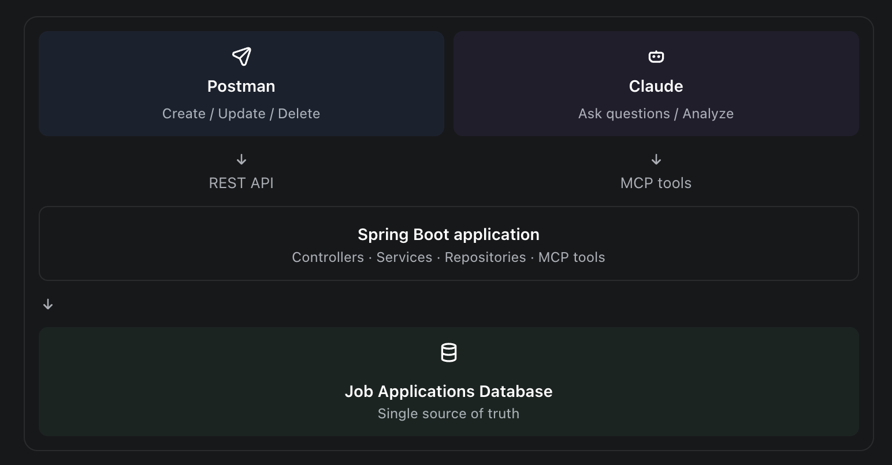

# RoboJob

A Spring Boot-based job application management system that provides RESTful CRUD operations for tracking and managing job applications using an H2 database. The application integrates with Claude AI through the Model Context Protocol (MCP), enabling intelligent analysis of job applications and AI-powered insights into the job search process.

## Features

- **Job Application Management:** Create, retrieve, update, and delete job application records.
- **REST API:** Exposes endpoints for managing job applications.
- **H2 Database:** Lightweight database for storing job application data.
- **Postman Integration:** Interact with CRUD endpoints through Postman.
- **Claude AI Integration:** Connects to Claude through an MCP server, allowing AI-powered analysis of job application data.

## Getting Started

### Prerequisites

Make sure you have the following installed:

- Java (JDK 17 or the version configured in the project)
- Maven
- Postman
- Cloudflared
- Claude Desktop or another Claude client that supports remote MCP connections


### 1. Clone the repository

```bash
git clone <YOUR_REPOSITORY_URL>
cd RoboJob
```

### 2. Start the Spring Boot application

Run the application using Maven:

```bash
./mvnw spring-boot:run
```

Alternatively, if Maven is installed globally:

```bash
mvn spring-boot:run
```

The application will start locally on:

```text
http://localhost:8080
```

Make sure the application starts successfully before proceeding.

## Architecture

The following diagram illustrates the overall architecture of RoboJob and the interactions between its main components.

<div align="center">
  
</div>

## API Usage with Postman

RoboJob exposes RESTful endpoints that allow you to manage job applications.

You can use Postman to interact with the API and perform the following operations:

| HTTP Method | Endpoint | Description |
|---|---|---|
| GET | `/api/jobApplications` | Retrieve all job application records |
| POST | `/api/jobApplication` | Add a new job application |
| PUT | `/api/jobApplication/{id}` | Modify an existing job application |
| DELETE | `/api/jobApplications/{id}` | Remove a job application |

Configure your Postman requests to target the appropriate API endpoints running on `localhost:8080`.

For POST and PUT requests, select `Body → raw → JSON` and provide the job application data in JSON format.

## Claude AI Integration (MCP)

RoboJob integrates with Claude through the Model Context Protocol (MCP), allowing Claude to interact with the job application management system and perform AI-powered analysis.

Since the Spring Boot application runs locally, a tunnel is required to expose the MCP endpoint to Claude.

### 1. Start a Cloudflare Tunnel

With the Spring Boot application running, open a new terminal and execute:

```bash
cloudflared tunnel --url http://localhost:8080
```

Cloudflared will generate a publicly accessible URL, typically in the following format:

```text
https://your-random-subdomain.trycloudflare.com/mcp
```

Keep this terminal running while using Claude. The tunnel must remain active for Claude to communicate with your local application.


### 2. Connect RoboJob to Claude

1.  Copy the public HTTPS URL generated by Cloudflared.
2.  Open Claude and navigate to **Settings → Connectors** (or the equivalent MCP configuration section in your Claude client).
3.  Add a new remote MCP connection.
4.  Use the Cloudflare Tunnel URL, including the `/mcp` endpoint:
```text
https://your-random-subdomain.trycloudflare.com/mcp
```
5.  Complete the connection process and authorize access if prompted.

Once connected, Claude can discover and use the tools exposed by RoboJob's MCP server.

### 3. Analyze Your Job Applications

After establishing the connection, you can interact with Claude and ask it to analyze your job application data.

For example, you can ask Claude to:
-   Summarize your current job application pipeline.
-   Analyze the status of your applications.
-   Identify trends across companies and application outcomes.
-   Provide insights to help organize and prioritize your job search.
